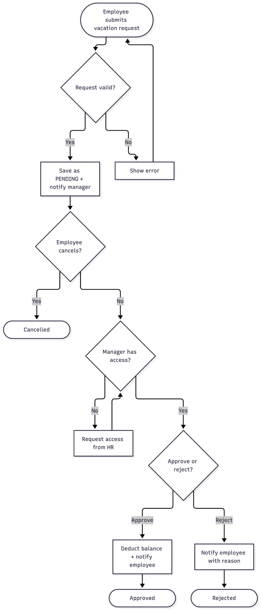
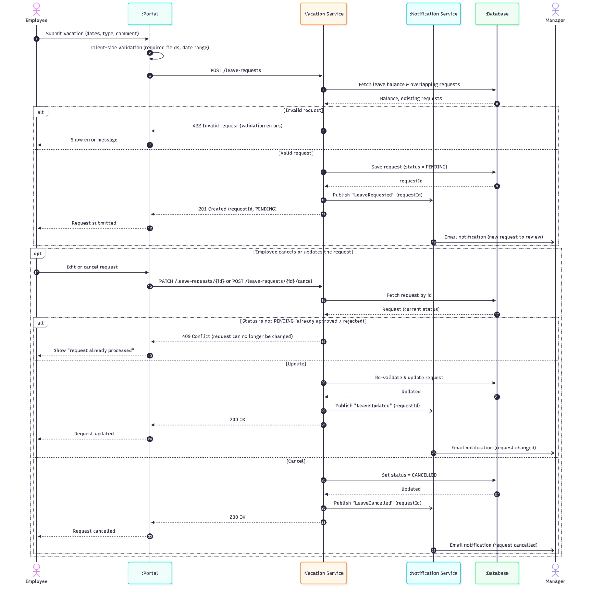
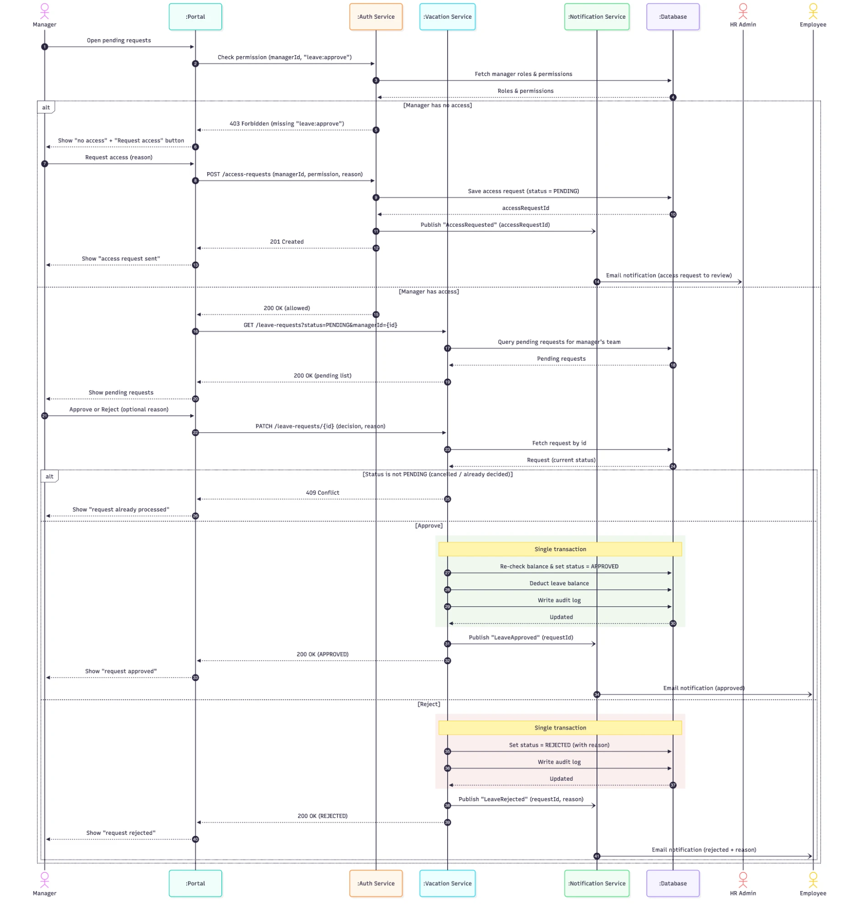
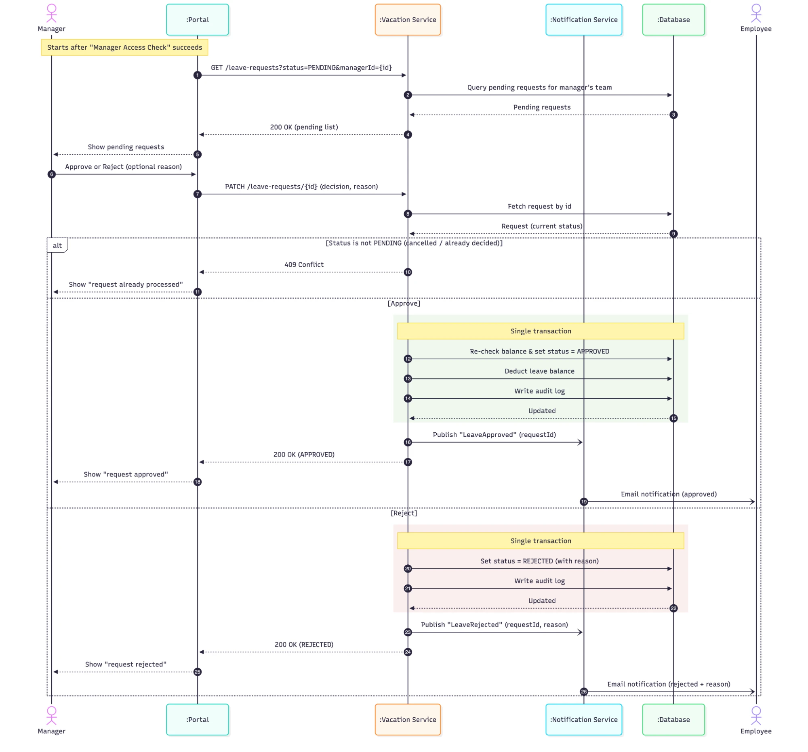
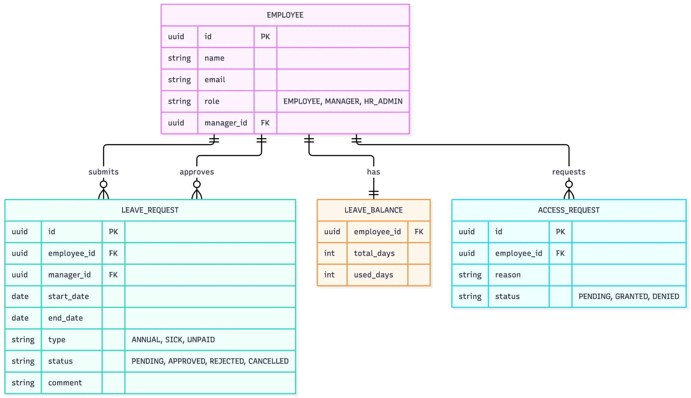

# Manage Time Use Case

## Overview

_Describe the goal of the Manage Time use case._

## Actors

- _Who interacts with the system?_

## Requirements

### Functional

| ID | Requirement | Actor |
|---|---|---|
| FR-01 | Submit a vacation request with dates, type (`ANNUAL`, `SICK`, `UNPAID`) and an optional comment | Employee |
| FR-02 | Validate the request: required fields, valid date range, enough leave balance, no overlap with existing requests | System |
| FR-03 | Save a valid request with status `PENDING` and notify the manager | System |
| FR-04 | Edit or cancel a request while it is still `PENDING` | Employee |
| FR-05 | Reject edits or cancellation of a request that is already approved or rejected (`409 Conflict`) | System |
| FR-06 | Check that the manager has the `leave:approve` permission before showing requests | System |
| FR-07 | Request missing access from HR, with a reason | Manager |
| FR-08 | Review access requests and grant or deny them | HR Admin |
| FR-09 | List pending requests for the manager's team | Manager |
| FR-10 | Approve a request: re-check balance, deduct leave days, set status `APPROVED` | Manager |
| FR-11 | Reject a request with a reason and set status `REJECTED` | Manager |
| FR-12 | Notify the employee by email when a request is approved or rejected | System |

### Non-Functional

| ID | Category | Requirement |
|---|---|---|
| NFR-01 | Security | Every manager action is authorized through the Auth Service using role-based permissions |
| NFR-02 | Consistency | Status change and balance deduction are written in a single DB transaction |
| NFR-03 | Concurrency | A request can be decided only once; deciding a non-`PENDING` request returns `409 Conflict` |
| NFR-04 | Reliability | Notifications are sent asynchronously through events, so an email failure does not fail the request |
| NFR-05 | Usability | Validation errors are returned as `422` with clear messages shown to the user |
| NFR-06 | Performance | Listing pending requests and submitting a request respond in under 500 ms (p95) |
| NFR-07 | Availability | The Vacation Service targets 99.9% uptime |
| NFR-08 | Responsiveness | The portal is responsive, so users can submit and review requests from a mobile device |

## Flow

1. _..._

## Diagrams

Diagrams for this use case live in [`diagrams/`](diagrams/).

### 1. Vacation Request Flowchart

End-to-end flow: submission and validation, employee cancellation, manager access check, and the approve / reject decision.

### 2. Employee Submits Vacation Request (Sequence)

Employee submits a request (validated, saved as `PENDING`, manager notified), then optionally edits or cancels it while it is still pending.

### 3. Manager Access Check and Review (Sequence)

Auth Service checks the `leave:approve` permission. Without access, the manager requests it from HR Admin. With access, the manager reviews and approves or rejects.

### 4. Manager Reviews Request (Sequence)

Review flow only, starting after the access check succeeds: list pending requests, handle `409 Conflict` for already processed ones, and approve (deduct balance) or reject (with reason) in a single transaction.

### 5. Data Model (ERD)

Entities: `EMPLOYEE` (roles `EMPLOYEE`, `MANAGER`, `HR_ADMIN`; self-referencing `manager_id`), `LEAVE_REQUEST` (submitted by an employee, approved by a manager), `LEAVE_BALANCE` (one per employee), and `ACCESS_REQUEST` (permission requests to HR).

