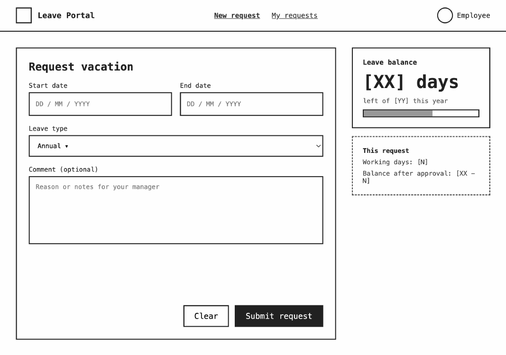
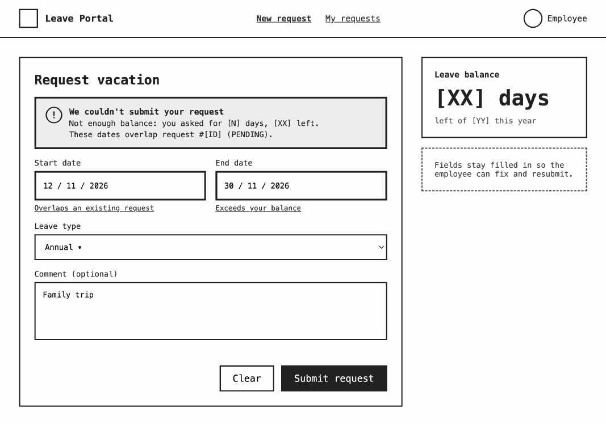
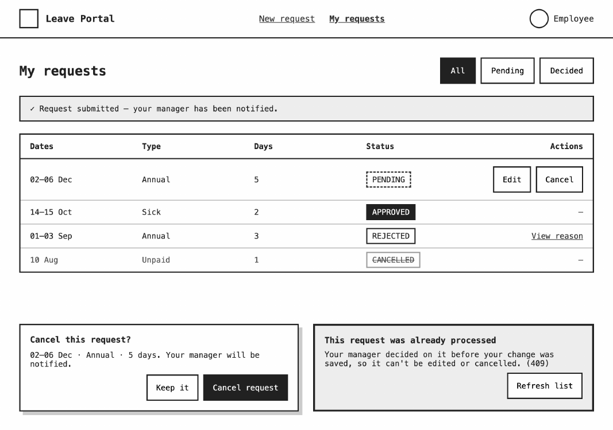
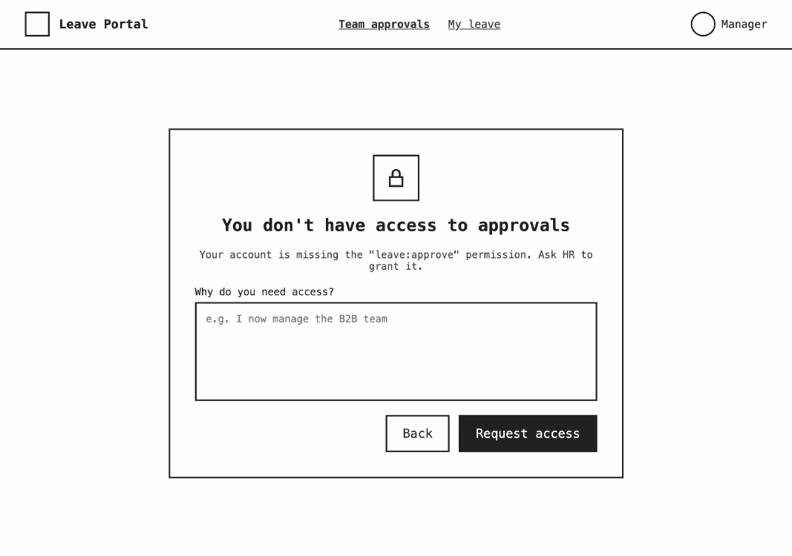
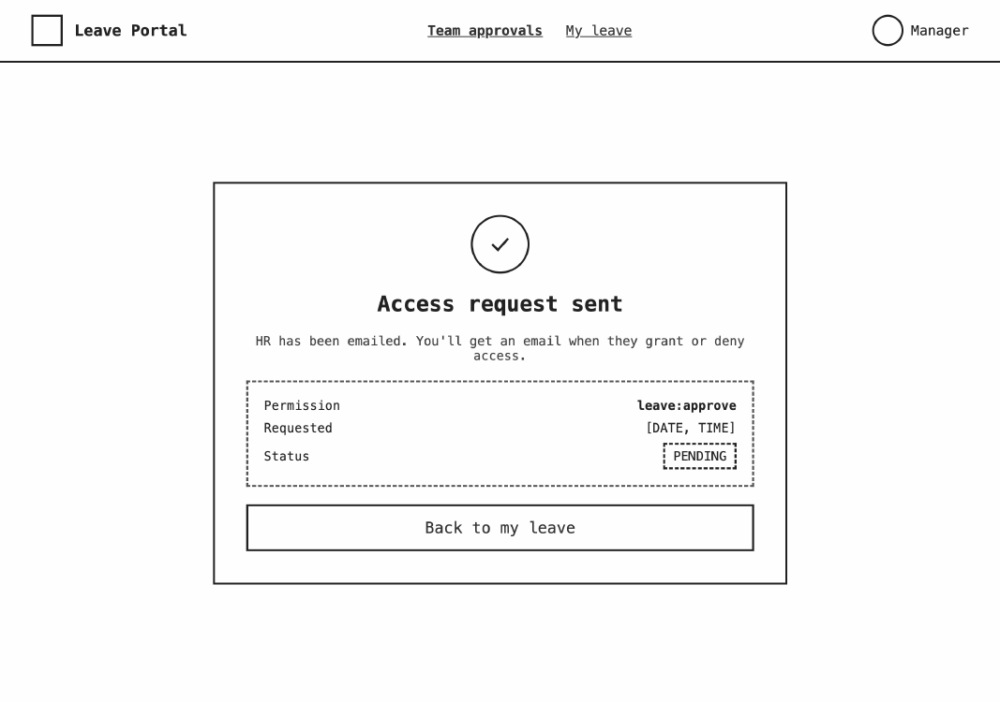
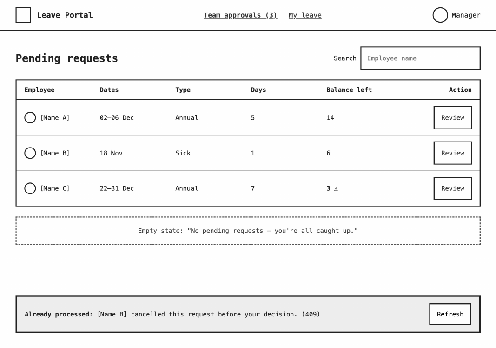
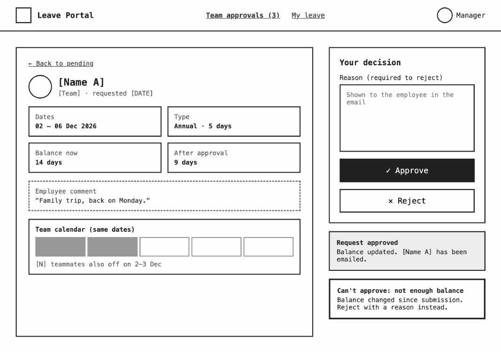
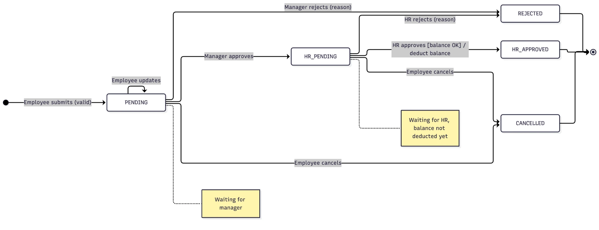
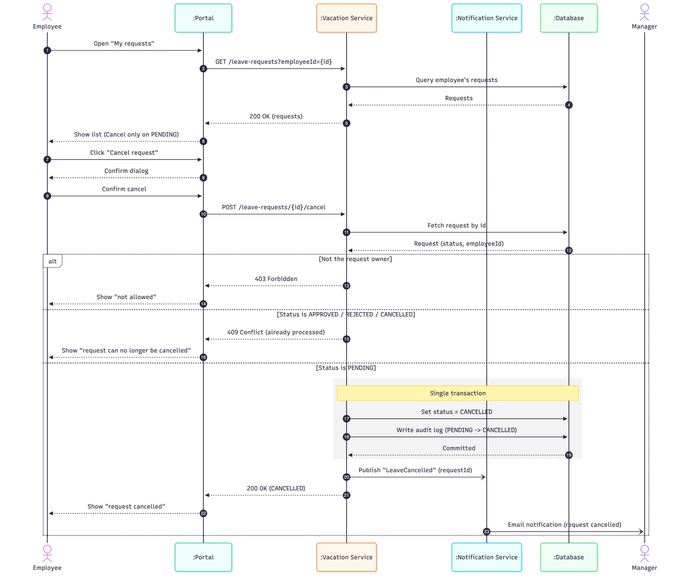

# Session 2 — Manage Time 
-  UI for Request Leave and Manager Approval















## What changes if we add `HR_PENDING` and `HR_APPROVED`?

`HR_APPROVED` becomes the final approved state and replaces `APPROVED`. If you'd rather keep `APPROVED` as the final name, use `MANAGER_APPROVED` / `HR_PENDING` instead; the flow is the same.

### 1. Data model

- Add the new values to the `status` enum: `PENDING`, `HR_PENDING`, `HR_APPROVED`, `REJECTED`, `CANCELLED`.
- Optionally add `hr_reviewed_by` next to `manager_id`, to know which HR person decided.
- No new tables.

### 2. Approval sequence

Reuse the same `PATCH /leave-requests/{id}` endpoint. The service decides the next status from the reviewer's role:

- **Manager approves a `PENDING` request** → set it to `HR_PENDING` and notify HR. Don't deduct the balance yet.
- **HR approves an `HR_PENDING` request** → re-check the balance, set it to `HR_APPROVED`, deduct the balance, write the audit log, and notify the employee. This is the transaction block that used to run on manager approval.
- **Rejection at either step** → set `REJECTED` and notify the employee with the reason.
- **`409 Conflict`** becomes "the status isn't the one this reviewer is allowed to act on".

### 3. UI

- **My requests:** new `HR_PENDING` badge (waiting for HR), and `HR_APPROVED` replaces `APPROVED`. Edit / Cancel stay available only while `PENDING`.
- **Manager review:** success message becomes "Approved — sent to HR for final approval."
- **HR approvals:** HR gets the same pending list and review page, filtered to `HR_PENDING` requests.

## State Diagram



## Withdrawal Sequence Diagram



## Pseudo Code

```text
// PATCH /leave-requests/{id}
// body: { decision: "APPROVE" | "REJECT", reason? }

function reviewLeaveRequest(requestId, reviewer, decision, reason):
    request = db.findLeaveRequest(requestId)
    if request is null:
        return 404 Not Found

    // Which status this reviewer is allowed to act on
    if reviewer.hasPermission("leave:approve") and request.status == PENDING:
        step = MANAGER
    else if reviewer.hasPermission("leave:hr_approve") and request.status == HR_PENDING:
        step = HR
    else if not reviewer.hasAnyPermission("leave:approve", "leave:hr_approve"):
        return 403 Forbidden
    else:
        return 409 Conflict    // already processed or not this reviewer's step

    // Case 1: rejection at either step
    if decision == REJECT:
        if reason is empty:
            return 422 "Reason is required to reject"
        request.status = REJECTED
        request.reason = reason
        saveReviewer(request, step, reviewer)
        db.save(request)
        events.publish("LeaveRejected", request)          // email employee with reason
        return 200 request

    // Case 2: manager approves a PENDING request
    if step == MANAGER:
        request.status = HR_PENDING
        request.manager_id = reviewer.id
        db.save(request)                                  // no balance deduction yet
        events.publish("LeaveAwaitingHR", request)        // notify HR
        return 200 request

    // Case 3: HR approves an HR_PENDING request (final approval)
    if step == HR:
        transaction:
            balance = db.findBalanceForUpdate(request.employee_id)   // row lock
            if balance.remaining < request.days:
                rollback
                return 422 "Not enough balance"
            balance.remaining -= request.days
            request.status = HR_APPROVED
            request.hr_reviewed_by = reviewer.id
            db.save(balance)
            db.save(request)
            auditLog.write("LEAVE_APPROVED", request, reviewer)
        events.publish("LeaveApproved", request)          // email employee
        return 200 request


function saveReviewer(request, step, reviewer):
    if step == MANAGER:
        request.manager_id = reviewer.id
    else:
        request.hr_reviewed_by = reviewer.id
```

```text
// Employee edit / cancel — allowed only while PENDING

function cancelLeaveRequest(requestId, employee):
    request = db.findLeaveRequest(requestId)
    if request.employee_id != employee.id:
        return 403 Forbidden
    if request.status != PENDING:
        return 409 Conflict    // already moved to HR_PENDING, HR_APPROVED or REJECTED
    request.status = CANCELLED
    db.save(request)
    events.publish("LeaveCancelled", request)             // notify manager
    return 200 request
```
