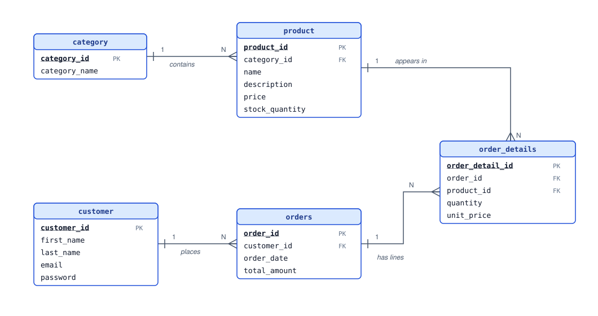
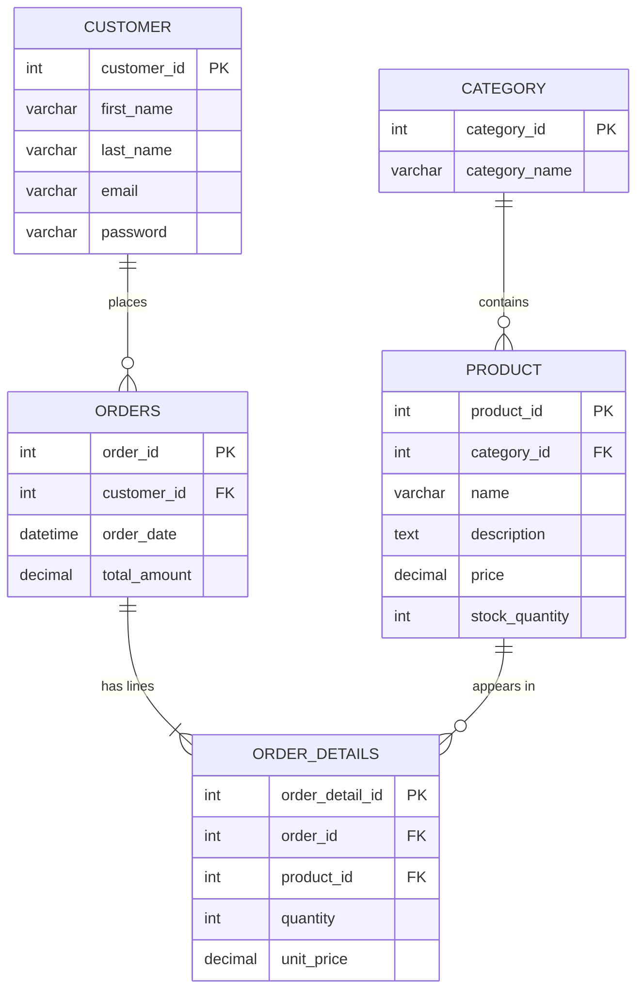

# Session 3 — E-commerce Database Design

Given the sample entities (Category, Product, Customer, Order, Order_details):

- **DB schema script:** [schema.sql](schema.sql) (PostgreSQL — `order` is a reserved word, so the table is named `orders`)
- **Report queries:** [queries.sql](queries.sql)

## Relationships

| Relationship | Cardinality | Via |
|---|---|---|
| Category — Product | 1 : N | `product.category_id` → `category.category_id` |
| Customer — Order | 1 : N | `orders.customer_id` → `customer.customer_id` |
| Order — Order_details | 1 : N | `order_details.order_id` → `orders.order_id` |
| Product — Order_details | 1 : N | `order_details.product_id` → `product.product_id` |
| Order — Product | M : N | resolved by the `order_details` junction table |

Notes:

- `order_details` is the junction table that breaks the many-to-many between orders and products; each row is one line item, and `(order_id, product_id)` is unique.
- `order_details.unit_price` is a snapshot of the product price at purchase time, so changing `product.price` later doesn't rewrite the history of old orders.
- Deleting an order cascades to its details; deleting a category, customer, or product that is referenced is restricted.

## ERD

## How can we apply denormalization on Customer and Order?

Denormalization = deliberately storing redundant / derived data to make frequent reads cheaper, at the cost of extra writes and a consistency risk. For these two entities:

### 1. `orders.total_amount` (already in the schema)

The order total is derivable: `SUM(quantity * unit_price)` over the order's `order_details`. Storing it on the order means every report over orders (daily revenue, customer spend) aggregates one row per order instead of joining and summing the details table.

- **Kept in sync:** compute it inside the same transaction that inserts/updates the order's line items.

### 2. Customer snapshot on the order

Copy `customer_name` (and shipping email/address if added later) onto `orders` at checkout time. An order is a historical document — if the customer later renames or changes email, old invoices should still show the data as it was. It also lets order lists render without joining `customer`.

### 3. Aggregates on the customer

Add derived columns to `customer` that reports and the UI read constantly:

- `orders_count`
- `total_spent` (lifetime value)
- `last_order_date`

A query like "customers who spent more than $500" becomes an indexed single-table read instead of a join + `GROUP BY` + `HAVING` over the whole orders table.

- **Kept in sync:** update in the checkout transaction, via triggers, or recompute with a scheduled batch job if slight staleness is acceptable.

### Trade-offs

| Pros | Cons |
|---|---|
| Fewer joins/aggregations on hot read paths | Writes touch more rows (slower, more lock contention) |
| Reports read one row instead of scanning details | Redundant data can drift if an update path is missed |
| Historical correctness (price/name snapshots) | More storage, more code to maintain |

Rule of thumb: keep the normalized tables as the source of truth, denormalize only measured hot paths, and maintain the copies inside the same transaction (or an async job when staleness is fine).
